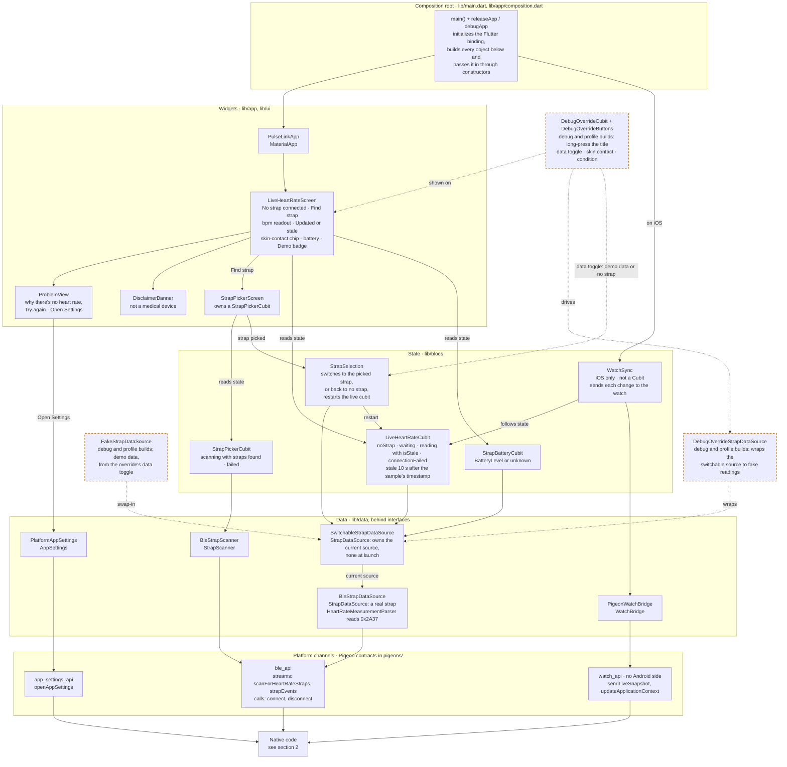
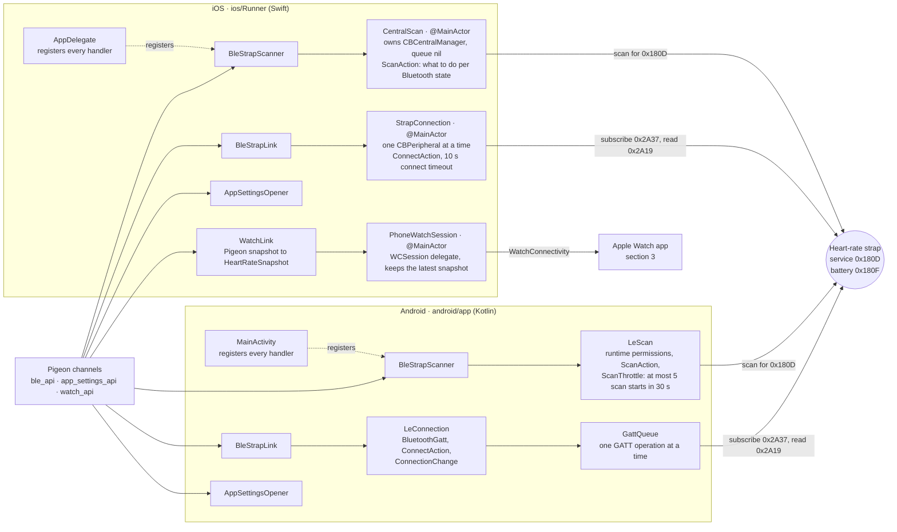
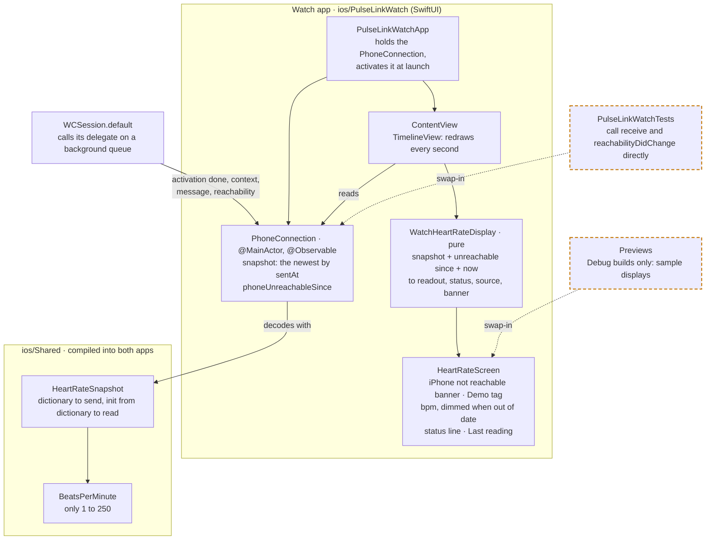
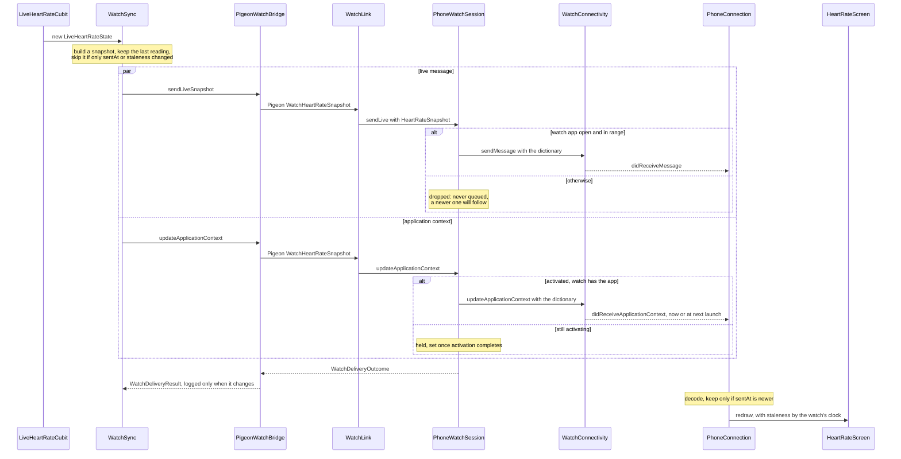

# PulseLink architecture

How the phone app, the Apple Watch app and the link between them fit
together, as of Milestone 5, plus the no-strap start and debug-only demo
data that came after it. Update it when a milestone changes a component
or a message; Milestone 6 will add the connection state machine, and
Milestone 8 the watch's start and stop commands.

The diagrams show the live path: a real strap, the real platform channels and
a real watch. Swap points, where a demo, debug or test component takes a live
one's place, are drawn as dashed amber boxes on dotted arrows, and listed in
a table after each diagram.

Arrows read "uses" or "sends to" unless labelled.

## 1. Phone app: Flutter (Dart)

Dart is in four layers. Each depends only on the layer below it, and each
data-layer component sits behind an interface, so it can be swapped for a
fake.



| Layer | Component | What it does |
| --- | --- | --- |
| Root | `main()` | Creates the app's one `TrackerService`, which it passes to everything that reports errors. Installs `UncaughtErrorReporter` first, which reports any error nothing else caught (a bug, never an expected failure) to `TrackerService` as fatal, while keeping Flutter's own handling. Then gathers the platform's pieces (`AppPlatform`), then builds the app once: `releaseApp` in release builds, or `debugApp` in debug and profile builds, which adds demo data and the debug override. Gives `WatchSync` a bridge on iOS only, through an exhaustive switch on the platform. |
| Widgets | `LiveHeartRateScreen` | Shows the cubits' state. Holds no logic beyond choosing what to draw. |
| Widgets | `StrapPickerScreen` | Lists straps while scanning. Its `BlocProvider` creates the picker cubit and closes it with the screen. |
| State | `LiveHeartRateCubit` | Turns the source's samples, failures and connection drops into screen state. A timer marks a reading stale 10 seconds after its timestamp. |
| State | `StrapBatteryCubit` | The strap's battery level, kept apart so a battery update doesn't redraw the readout. |
| State | `StrapSelection` | Switches the switchable source to the picked strap, back to no strap (`clear`), or, in debug and profile builds, to demo data, then restarts the live cubit. |
| State | `WatchSync` | Sends a snapshot of the live state to the watch at start and on each change (section 3). |
| Data | `SwitchableStrapDataSource` | Owns whichever `StrapDataSource` is current, so the cubits never change source themselves. Starts with none, reporting no strap until one is picked. |
| Data | `BleStrapDataSource` | The strap through `ble_api`. Parses raw Heart Rate Measurement bytes in exactly one place. Expected failures come back as typed results, never exceptions. |
| Data | `PigeonWatchBridge` | The watch through `watch_api`. Turns platform errors into a `WatchDeliveryResult`. |
| Data | `TrackerService` | Where errors are reported from: fatal from `UncaughtErrorReporter`, non-fatal from `AppBlocObserver` and from the platform-channel failures `BleStrapDataSource` and `PlatformAppSettings` catch. Logs through `dart:developer` for now; a crash reporting service, and Milestone 6's in-app debug log, would plug in there. Expected failures and normal events, such as a malformed packet, don't go through it. |

### Swap points

| Interface or slot | Live | Swap-ins |
| --- | --- | --- |
| `StrapDataSource` (current source) | none at launch, then `BleStrapDataSource` | `FakeStrapDataSource`, demo data in debug and profile builds only (`lib/data/debug/`). Tests: `StubStrapDataSource`, `FailingStrapDataSource`. |
| `StrapDataSource` (what the cubits see) | `SwitchableStrapDataSource` | `DebugOverrideStrapDataSource` wraps it in debug and profile builds, to fake skin contact, a bpm of 0, an implausible bpm or no data on demand. |
| Debug controls | none in release | `DebugOverrideCubit` and `DebugOverrideButtons`, shown by long-pressing the title; the first button switches between demo data and real data. `kReleaseMode` leaves them, and demo data, out of release builds, and the pre-merge checks look for them in the binaries. |
| `StrapScanner` | `BleStrapScanner` | Tests: `StubStrapScanner`. |
| `AppSettings` | `PlatformAppSettings` | Tests: `StubAppSettings`. |
| `WatchBridge` | `PigeonWatchBridge` | Tests: `FakeWatchBridge`, which records snapshots and can fail before or after returning a future. |
| `TrackerService` | the one `main()` creates, a required constructor argument wherever errors are reported | Tests: `RecordingTrackerService`, which records each error. |
| Clock | system clock | Tests: `package:clock` with a fixed or fake-async clock, for staleness and `sentAt`. |

## 2. Phone app: native code

Each Pigeon contract has a generated handler that native code implements.
On both platforms everything that talks to Dart runs on the main thread,
the only thread Flutter accepts messages on.

Errors that shouldn't happen, such as a call off the main thread or a
permission revoked after it was checked, go to an `ErrorTracker`, the native
counterpart of Dart's `TrackerService`. `AppDelegate` creates the iPhone
app's (`OSLogTracker`, unified log) and `MainActivity` Android's
(`LogcatTracker`), and each passes it to everything below that reports
errors. It works on any thread, so it doesn't send to Dart. Expected
failures go back to Dart as typed results instead.



| Message | Direction | Shape |
| --- | --- | --- |
| `scanForHeartRateStraps` | native to Dart, a stream while listened to | `BleScanStarted` · `BleStrapFound(id, name, isConnected)` · `BleScanFailed(poweredOff / unauthorized / unsupported)` |
| `connect(strapId)` | Dart to native, async | `BleConnected` · `BleConnectCancelled` · `BleConnectFailed(poweredOff / unauthorized / unsupported / unreachable / notAHeartRateStrap)` |
| `strapEvents` | native to Dart, a stream | `BleHeartRateMeasurement(bytes)` · `BleBatteryLevel(percent)` · `BleStrapDisconnected` |
| `openAppSettings` | Dart to native | `bool`: whether Settings opened |
| `sendLiveSnapshot`, `updateApplicationContext` | Dart to native, iOS only, async | a `WatchHeartRateSnapshot` in, a `WatchDeliveryOutcome` back (section 3) |

There's no native swap-in in the app itself. Swift Testing and JUnit tests
exercise the pure decision types (`ScanAction`, `ConnectAction`,
`WatchSessionState` and the delivery actions, `GattQueue`, `ScanThrottle`)
without a phone, and Swift tests pass `RecordingErrorTracker` to check what's
reported, such as by `isOnMainThread` off the main thread.

## 3. Watch app

A native SwiftUI app embedded in the iOS app. It never connects to the strap.
It shows the newest snapshot the phone sent, and works out for itself
whether the reading is stale.



What the watch shows for each case, worked out by `WatchHeartRateDisplay`:

| Phone status | Latest reading | Number | Status line |
| --- | --- | --- | --- |
| no snapshot yet | | `--` | Open PulseLink on your iPhone |
| receiving | measured, under 10 s old | bpm | Updated 10:04:31 AM |
| receiving | measured, 10 s old or more | bpm, dimmed | No data from strap · Last reading … |
| receiving | unavailable, under 10 s old | `--` | No skin contact / Strap connected, no heart rate yet / Strap reading out of range |
| receiving | unavailable, 10 s old or more | `--` | No data from strap · Last reading … |
| noStrap | none | `--` | No strap connected · Pick one in PulseLink on your iPhone |
| waiting | any or none | last bpm dimmed, or `--` | Waiting for heart-rate data… |
| failed | any or none | last bpm dimmed, or `--` | the phone's title: Bluetooth is off, Can't reach the strap, Strap disconnected… |

On top of any of these: a "Demo" tag in demo mode, and an "iPhone not
reachable" banner once WatchConnectivity has reported the iPhone unreachable
for 5 seconds in a row. It reports that for a moment whenever the app wakes,
such as on raising the wrist, and the grace period keeps the banner from
flashing. A reading stamped ahead of the watch's clock counts as 0 seconds
old.

| Swap point | Live | Swap-in |
| --- | --- | --- |
| Data on `HeartRateScreen` | `WatchHeartRateDisplay` from `PhoneConnection` | `#Preview` sample displays, inside `#if DEBUG`; lint and binary checks keep them out of release builds |
| `PhoneConnection`'s input | `WCSession` delegate callbacks | Tests call `receive(_:)`, `reachabilityDidChange(_:at:)` and `decode(_:from:)` directly |
| `PhoneConnection`'s error tracker | `OSLogTracker`, created by `PulseLinkWatchApp` | Tests: `RecordingErrorTracker`, which records each error |
| Time | `TimelineView`'s date | Tests pass a fixed `now` to `WatchHeartRateDisplay` |

## 4. Phone to watch

One-way for now: the phone sends snapshots and the watch only listens.
Start and stop commands from the watch are planned for Milestone 8, and the
message's `kind` field leaves room for them.

### One change, end to end



### Delivery decisions on the phone

`PhoneWatchSession` reduces the `WCSession`'s properties to one state, then
decides each send from it.

| `WatchSessionState` | Live message | Application context |
| --- | --- | --- |
| `unsupported`: the device can't pair a watch, such as an iPad | drop: `unsupported` | drop: `unsupported` |
| `activating`: not activated yet, or switching watches | drop: `watchUnreachable` | hold: `pending` |
| `noWatchApp`: no paired watch, or it lacks the app | drop: `noWatchApp` | drop: `noWatchApp` |
| `watchAppNotReachable`: app installed, closed or out of range | drop: `watchUnreachable` | update: `sent` |
| `watchAppReachable`: app open and in range | send: `sent` | update: `sent` |

`updateApplicationContext` throwing gives `failed`. In Dart, Pigeon's
`channel-error` (no native handler) becomes `unsupported`, and any other
`PlatformException` becomes `failed`.

Because Dart only sends on a change, the phone also keeps the latest
snapshot and sends it again when the watch side changes:

| Event on the phone | What `PhoneWatchSession` does |
| --- | --- |
| Activation completes | Sets the latest snapshot as the application context |
| `sessionWatchStateDidChange`: a watch paired or unpaired, the app installed or removed | Sets the latest snapshot as the application context |
| `sessionReachabilityDidChange` to reachable: the watch app opened | Sends the latest snapshot as a live message |
| `sessionDidDeactivate`: the user switched watches | Activates again, which then sets the latest snapshot on the new watch |

And on the watch:

| Event on the watch | What `PhoneConnection` does |
| --- | --- |
| Activation completes | Reads `receivedApplicationContext`, if any, and `isReachable` |
| Context or message arrives | Decodes it. Keeps it only if its `sentAt` is newer than the one shown; the same snapshot often arrives both ways. |
| Message can't be decoded | Logs it and keeps showing the last good snapshot |
| Reachability changes | Records when the iPhone became unreachable, or clears it. The banner shows once that's 5 seconds ago. |

### One snapshot, four shapes

The same snapshot changes type at each boundary. Every conversion is
failable on the receiving side, so a malformed message is rejected, not
shown.

| Field | Dart domain `WatchHeartRateSnapshot` | Pigeon `WatchHeartRateSnapshot` | Swift `HeartRateSnapshot` | Wire dictionary |
| --- | --- | --- | --- | --- |
| Format | | | | `version`: 1, `kind`: `"heartRateSnapshot"` |
| Sent | `sentAt: DateTime` | `sentAtMillis: int` | `sentAt: Date` | `sentAt`: seconds since 1970, a Double |
| Source | `isSimulated: bool` | `source: WatchHeartRateSource` (demo, strap) | `source: HeartRateSource` | `source`: `"demo"` or `"strap"` |
| Status | `WatchHeartRateStatus`: noStrap, waiting, receiving, failed with a `StrapConnectionFailure` | `WatchNoStrap`, `WatchWaiting`, `WatchReceiving`, `WatchFailed(WatchStrapFailure)` | `HeartRateStatus`: `.noStrap`, `.waiting`, `.receiving`, `.failed(StrapConnectionFailure)` | `status`: `"noStrap"`, `"waiting"`, `"receiving"` or `"failed"`, plus `failure` when failed |
| Latest reading | `HeartRateSample?`: measured with bpm, timestamp, skin contact and RR intervals, or unavailable with a reason | `WatchMeasuredReading(beatsPerMinute, measuredAtMillis)` or `WatchUnavailableReading(reason, measuredAtMillis)`; skin contact and RR intervals stay on the phone | `HeartRateReading?`: `.measured(BeatsPerMinute, measuredAt:)` or `.unavailable(reason, measuredAt:)` | `latestReading`: absent before the first, otherwise `kind`, `bpm` or `reason`, and `measuredAt` |

Staleness isn't sent at any stage. The watch works it out from
`measuredAt`, so it stays right even when snapshots stop arriving.

### The wire format

What `WCSession` actually carries, as both the message and the application
context:

```text
[
  "version": 1,
  "kind": "heartRateSnapshot",
  "sentAt": 1794000000.0,           // seconds since 1970, by the phone's clock
  "source": "strap",                // or "demo"
  "status": "failed",               // or "noStrap", "waiting", "receiving"
  "failure": "connectionLost",      // only when status is "failed"
  "latestReading": [                // absent before the first reading
    "kind": "measured",             // or "unavailable"
    "bpm": 72,                      // only when measured; 1 to 250
    "reason": "noSkinContact",      // only when unavailable
    "measuredAt": 1793999998.5
  ]
]
```

| Key | Values |
| --- | --- |
| `status` | `noStrap`: no strap picked on the phone · `waiting`: starting up or connecting · `receiving`: readings are arriving · `failed`: see `failure` |
| `failure` | `bluetoothOff` · `bluetoothUnavailable` · `bluetoothPermissionDenied` · `strapUnreachable` · `notAHeartRateStrap` · `connectionLost` |
| `latestReading.kind` | `measured` · `unavailable` |
| `latestReading.reason` | `noSkinContact` · `zeroBeatsPerMinute` · `implausibleBeatsPerMinute` |

The watch rejects the whole snapshot for any other `version` or `kind`, an
unknown code, a missing or mistyped field, or a bpm outside 1 to 250.

### Delivery results

What comes back to Dart for each send. `WatchSync` logs a result only when
it differs from the last one, so a closed watch app doesn't log every
second.

| `WatchDeliveryResult` | Meaning |
| --- | --- |
| `sent` | Handed to WatchConnectivity |
| `pending` | Application context held until the session is activated |
| `watchUnreachable` | Live message dropped: the watch app is closed, out of range, or the session isn't activated yet |
| `noWatchApp` | No paired watch, or it doesn't have the app |
| `unsupported` | This device can't talk to a watch, or there's no native handler |
| `failed` | WatchConnectivity refused it, or another platform error |
